# SyncFund

**Aplicación web para la gestión de finanzas personales y gastos compartidos.**

Proyecto académico desarrollado para la asignatura de Construcción de Software del Politécnico Colombiano Jaime Isaza Cadavid.

🔗 **Demo en producción:** [syncfund.vercel.app](https://syncfund.vercel.app)

---

## Tabla de contenidos

- [Descripción](#descripción)
- [Características principales](#características-principales)
- [Arquitectura del sistema](#arquitectura-del-sistema)
- [Patrón de diseño: Observer](#patrón-de-diseño-observer)
- [Diagramas de diseño (UML)](#diagramas-de-diseño-uml)
- [Modelo de datos](#modelo-de-datos)
- [Instalación y ejecución](#instalación-y-ejecución)
- [Tecnologías](#tecnologías)
- [Recursos útiles](#recursos-útiles)
- [Colaboradores](#colaboradores)

---

## Descripción

SyncFund es una aplicación web que integra en un mismo sistema la administración de las finanzas personales de un usuario y la gestión de gastos realizados en grupo. Su propósito es que cada usuario pueda registrar y controlar sus propios ingresos y egresos y, a la vez, participar en fondos colectivos en los que el sistema distribuye los gastos entre los integrantes y determina el saldo de cada uno.

### Contexto

La gestión de gastos compartidos (vivienda, viajes, actividades grupales) suele llevarse por separado de las finanzas personales, lo que obliga a calcular manualmente cuánto aportó cada persona y cuánto adeuda. SyncFund unifica ambos registros: cada integrante aporta al fondo del grupo desde su billetera personal, el fondo paga los gastos compartidos y el sistema calcula cuánto le deben o cuánto debe cada uno según lo que aportó y los gastos en los que participó.

### Módulos del sistema

| Módulo | Responsabilidad |
|---|---|
| **Autenticación y usuarios** | Registro, inicio de sesión y emisión de tokens JWT. |
| **Billetera personal** (`PersonalWallet`) | Registro de movimientos (ingresos y gastos), meta de ahorro mensual y saldo de reserva ("colchón") que impide que el saldo quede en negativo. |
| **Proyectos compartidos** (`SharedProject`) | Creación de grupos, incorporación de integrantes por correo electrónico, aportes al fondo común (descontados de la billetera personal de quien aporta) y registro de gastos con selección de participantes, pagados por el fondo. |
| **Cálculo de deudas** (`DebtCalculator`) | Determinación del saldo neto de cada integrante: si está al día, si le deben o si debe. |
| **Categorías** | Clasificación de gastos con límite de presupuesto mensual y alerta cuando se supera. Cada categoría es privada de quien la crea. |

### Enfoque de desarrollo

El sistema se diseñó antes de su implementación mediante un modelo orientado a objetos documentado en UML: diagramas de clases, paquetes, componentes, secuencia, estados y despliegue, tarjetas CRC y modelo entidad-relación. La implementación respeta ese diseño y sigue una arquitectura en capas (presentación, aplicación, dominio y persistencia). El patrón Observer se aplica en el núcleo contable para propagar los cambios de saldo de un proyecto compartido a sus participantes.

En seguridad, además de la autenticación sin estado con JWT, el backend verifica en cada operación que el recurso solicitado pertenezca al usuario o que este sea miembro del proyecto. Un token válido no permite consultar ni modificar información de otro usuario.

Como riesgo aceptado, el registro y la incorporación de integrantes informan si un correo ya está registrado: ocultarlo dejaría a los usuarios sin saber por qué falló la acción y exigiría verificación por correo, que el sistema aún no tiene. El inicio de sesión, en cambio, responde igual ante un correo inexistente o una contraseña incorrecta. Esta decisión se revisará cuando se implemente la invitación de integrantes con aceptación.

### Decisiones técnicas relevantes

- **Patrón Observer sobre una API REST:** el patrón se mantuvo fiel al diseño original pese a que la comunicación entre cliente y servidor es sin estado.
- **Doble registro de los aportes:** un aporte queda como gasto en la billetera personal de quien aporta y como ingreso en el fondo del proyecto. Los gastos compartidos solo afectan el fondo, de modo que el dinero nunca se cobra dos veces y la suma de los saldos netos de los integrantes es igual al saldo del fondo.
- **El fondo no se sobregira:** un gasto compartido que supera el saldo del fondo se rechaza; primero hay que aportar.
- **Autorización por recurso:** se separó la verificación de identidad (autenticación) de la verificación de propiedad o membresía (autorización).

### Limitaciones y trabajo futuro

- Implementar el ciclo de vida completo de un proyecto compartido descrito en las máquinas de estado (Activo → En liquidación → Cerrado).
- Reemplazar la actualización de datos por consulta periódica (*polling*) por notificaciones en tiempo real mediante WebSockets.

## Características principales

- **Billetera personal**: registro de ingresos y gastos, meta de ahorro mensual con cálculo automático de cuota, y un "colchón" de seguridad que nunca permite dejar el saldo en negativo.
- **Proyectos compartidos**: crea un grupo, agrega integrantes por correo electrónico, aporta al fondo común desde tu billetera personal y registra gastos selectivos (eliges quién participa en cada uno) que paga el fondo. Si el fondo no alcanza, el gasto se rechaza.
- **Cálculo de deudas en tiempo real**: en todo momento puedes ver si estás "en paz", te deben, o debes, sin tener que hacer la cuenta a mano.
- **Categorías con alerta de presupuesto**: crea tus propias categorías de gasto, define un límite mensual para cada una y recibe aviso visual cuando lo superas. Solo tú puedes verlas y usarlas.
- **Seguridad**: autenticación con JWT y una capa de autorización que verifica, en cada petición, que el recurso solicitado pertenezca a quien hace la petición, no solo que haya iniciado sesión.

## Arquitectura del sistema

### Patrón arquitectónico: Arquitectura en Capas

El sistema se estructura según el patrón de **Arquitectura en Capas** (*Layered Architecture*) en su variante estricta: el software se divide en estratos lógicos horizontales y el flujo de información es unidireccional hacia abajo. Cada capa interactúa únicamente con la capa inmediatamente inferior y desconoce la existencia de las demás.

<p align="center">
  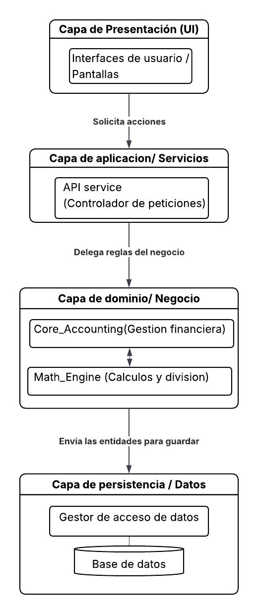
</p>

| Capa | Responsabilidad |
|---|---|
| **Presentación** | Interactúa con el usuario: captura sus acciones (por ejemplo, registrar un gasto) y muestra los saldos. No realiza cálculos financieros. |
| **Aplicación / Servicios** | Recibe las solicitudes de la capa de presentación, determina la operación requerida y delega su ejecución a la capa de dominio. |
| **Dominio / Negocio** | Contiene las reglas de negocio: gestión financiera (`Core_Accounting`), cálculo y división de gastos (`Math_Engine`) y el patrón Observer. No depende de cómo se presenta ni de cómo se almacena la información. |
| **Persistencia / Datos** | Única responsable del acceso al almacenamiento. Recibe las entidades del dominio y las guarda de forma permanente en la base de datos. |

#### Justificación

1. **Aislamiento del dominio financiero.** Las reglas financieras y el cálculo de deudas son el núcleo del sistema. Al ubicar `Core_Accounting` y `Math_Engine` en la capa de dominio, quedan aislados de la interfaz de usuario: ninguna petición externa puede alterar un saldo sin pasar antes por la validación de las capas superiores.
2. **Separación de responsabilidades.** La lógica de división de una cuenta no se mezcla con la presentación de la información ni con su almacenamiento, lo que evita un sistema monolítico y acoplado.
3. **Mantenibilidad e independencia tecnológica.** Gracias a la dependencia estricta hacia abajo, un cambio en la interfaz (por ejemplo, pasar de una aplicación web a una móvil) solo afecta la capa de presentación; las reglas de negocio permanecen intactas.

#### Correspondencia con el código

| Capa | Ubicación en el repositorio |
|---|---|
| Presentación | `syncfund-frontend/` (React) y `demo/.../presentation/controller` (endpoints REST) |
| Aplicación | `demo/.../application/service`, `dto`, `mapper` y `exception` |
| Dominio | `demo/.../domain/model`, `domain/observer`, `domain/service` (`FinancialManager`) y `domain/util` (`DebtCalculator`) |
| Persistencia | `demo/.../persistence/repository` (Spring Data JPA) y la base de datos MySQL |

Los paquetes `security` (JWT y autorización por recurso) y `config` (CORS y Spring Security) son transversales y se aplican antes de que la solicitud llegue a los controladores.

### Componentes

<p align="center">
  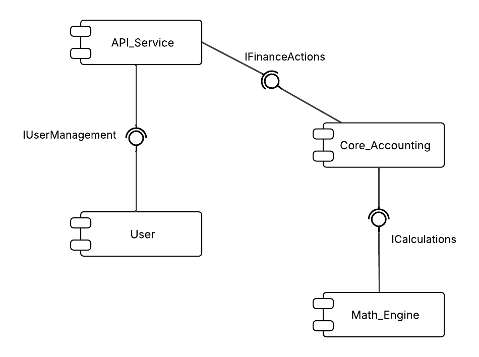
</p>

| Componente | Interfaz | Función |
|---|---|---|
| `API_Service` | — | Punto de entrada de las solicitudes del cliente. |
| `User` | `IUserManagement` | Registro, autenticación y datos del usuario. |
| `Core_Accounting` | `IFinanceActions` | Gestión de billeteras, proyectos compartidos y transacciones. Implementa el patrón Observer. |
| `Math_Engine` | `ICalculations` | Cálculos financieros: división de gastos, saldos netos y proyección de ahorro. |

## Patrón de diseño: Observer

Para el componente `Core_Accounting` se seleccionó el patrón de comportamiento **Observer**.

### Problema

En un proyecto compartido (`SharedProject`), varios usuarios (`User`) dependen del estado del saldo del grupo. Sin este patrón, cada usuario o vista tendría que consultar periódicamente el proyecto para saber si hubo nuevas transacciones, lo que genera carga innecesaria y un acoplamiento fuerte entre las entidades del dominio.

### Solución

`SharedProject` asume el rol de **sujeto observable** y mantiene una lista de **observadores**, que son sus participantes. Cuando su estado financiero cambia (al registrar un gasto, un aporte o una deuda pendiente), el proyecto notifica automáticamente a todos los participantes inscritos.

| Rol del patrón | Clase en SyncFund |
|---|---|
| Sujeto (*Subject*) | `IObservable`, implementada por `SharedProject` |
| Observador (*Observer*) | `IObserver`, implementada por `User` |
| Disparador de la notificación | `registerSelectiveExpense`, `distributeContribution`, `notifyPendingDebt` y `FinancialManager.processTransaction` |

### Justificación

1. **Bajo acoplamiento.** `SharedProject` no conoce los detalles de implementación de sus observadores; solo sabe que implementan `IObserver`.
2. **Principio abierto/cerrado (SOLID).** Se pueden agregar nuevos tipos de observadores (un servicio de auditoría o de notificaciones por correo, por ejemplo) sin modificar `SharedProject`.
3. **Consistencia de la información.** Cada cambio en el saldo del proyecto se propaga a todos los participantes, de modo que ningún usuario trabaja con información financiera desactualizada.

### Diseño

<p align="center">
  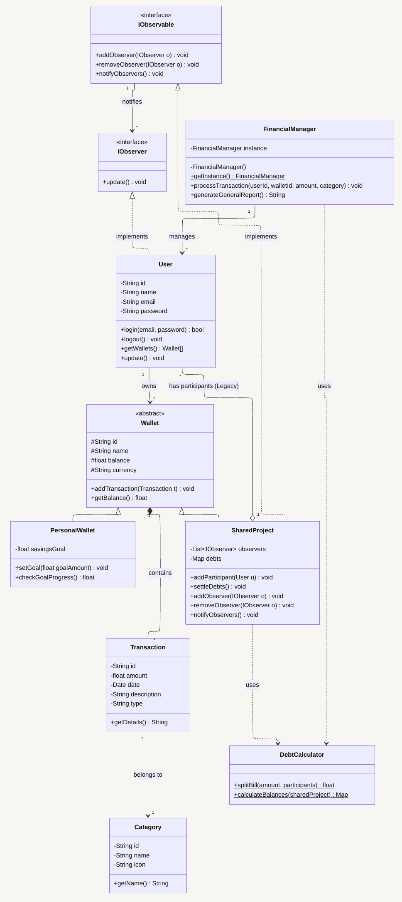
</p>

### Implementación

Las interfaces se encuentran en `demo/src/main/java/com/syncfund/domain/observer/`:

```java
public interface IObservable {
    void addObserver(IObserver observer);
    void removeObserver(IObserver observer);
    void notifyObservers(double amount, String description);
}

public interface IObserver {
    void update(String projectName, double newTransactionAmount, String description);
}
```

`SharedProject` recorre su lista de observadores y notifica a cada uno:

```java
@Override
public void notifyObservers(double amount, String description) {
    for (IObserver observer : observers) {
        observer.update(this.name, amount, description);
    }
}
```

Al incorporar un integrante con `addMember(user)`, este se registra automáticamente como observador del proyecto.

### Flujo de registro de un gasto compartido

El diagrama de actividades muestra la validación del gasto (monto mayor a cero, existencia del grupo y pertenencia del usuario), la verificación de que el fondo tenga saldo suficiente para pagarlo y la ejecución en paralelo del registro (`Core_Accounting`) y del cálculo de la división (`Math_Engine`), antes de notificar a los participantes mediante el patrón Observer.

<p align="center">
  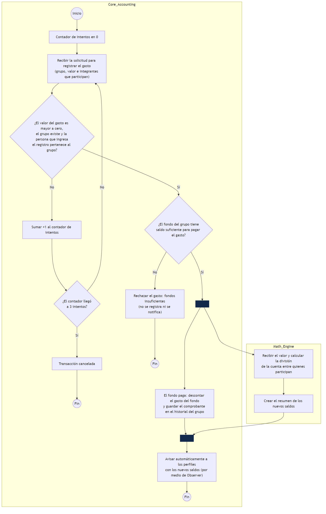
</p>

El diagrama de secuencia detalla los mensajes intercambiados entre `API_Service`, `SharedProject`, la base de datos, `DebtCalculator` y los usuarios observadores:

<p align="center">
  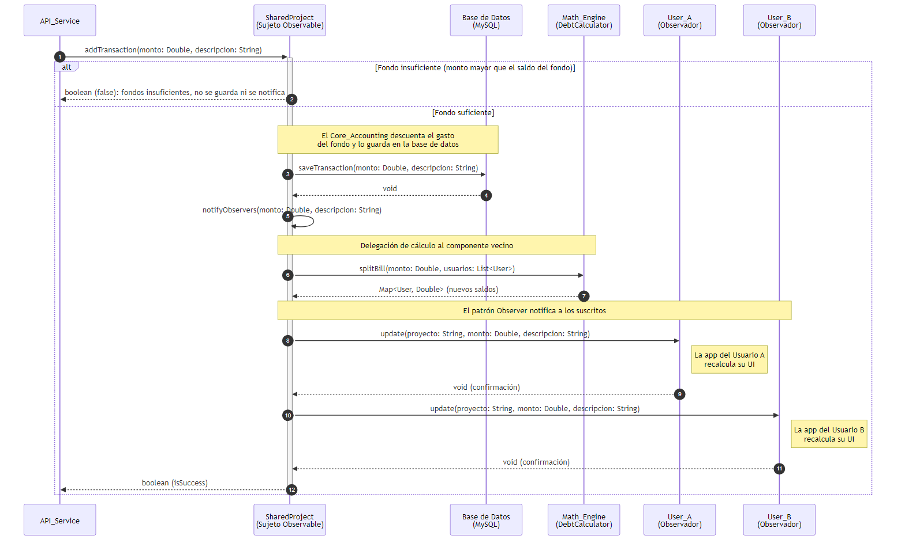
</p>

> En la implementación actual, la notificación ocurre dentro del backend. La interfaz web refleja los nuevos saldos al recargar los datos; el envío de notificaciones en tiempo real al navegador está contemplado como trabajo futuro (WebSockets).

## Diagramas de diseño (UML)

### Diagrama de clases

<p align="center">
  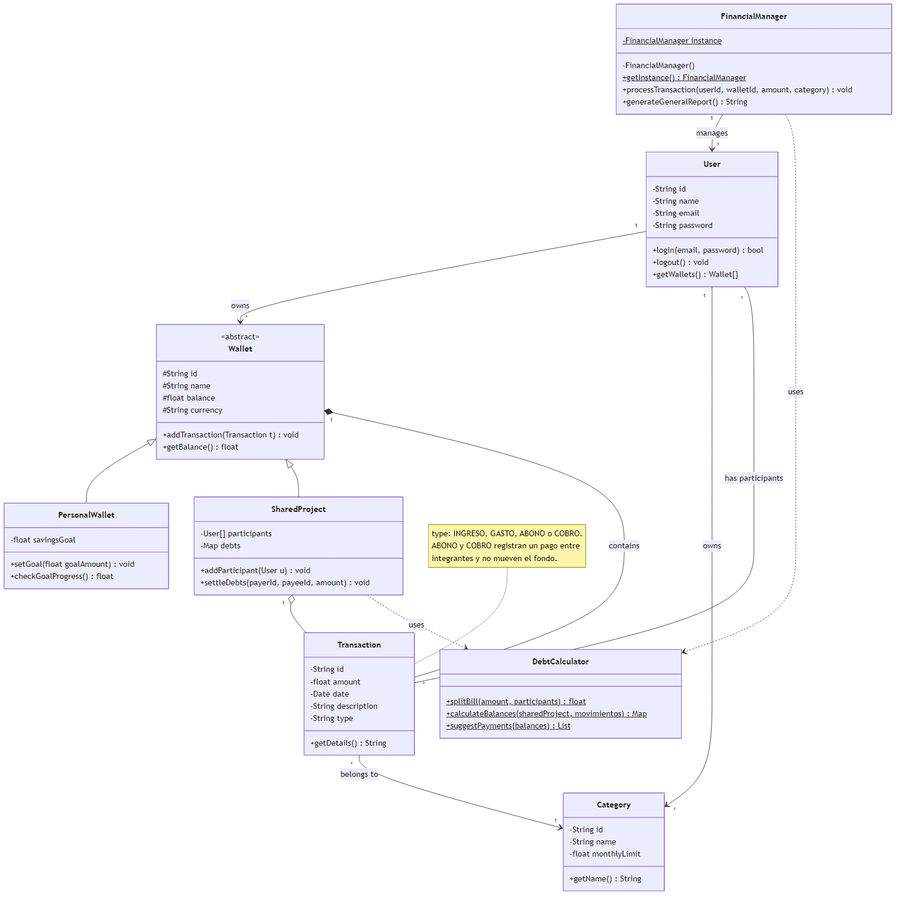
</p>

### Diagrama de paquetes

<p align="center">
  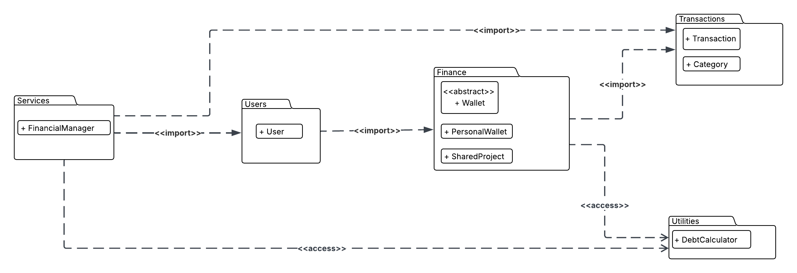
</p>

### Diagrama de despliegue

<p align="center">
  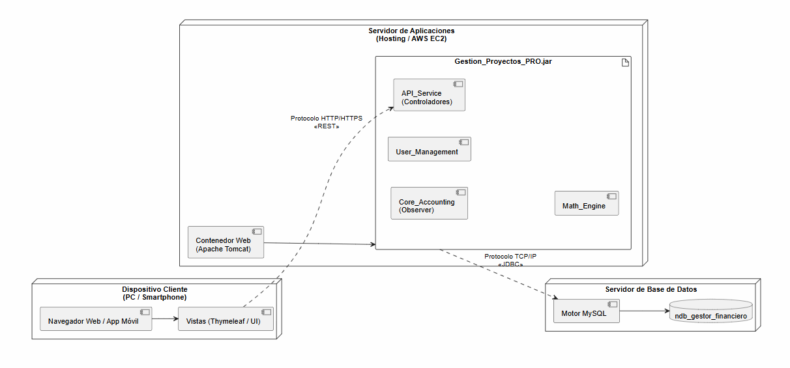
</p>

<details>
<summary><strong>Diagrama de objetos</strong></summary>
<br>
<p align="center">
  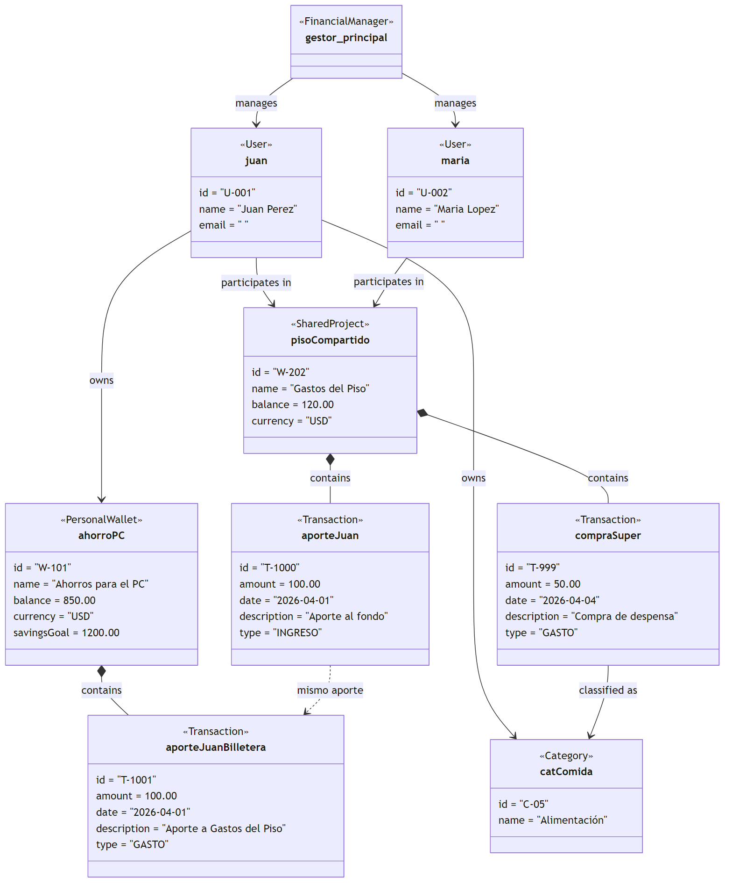
</p>
</details>

<details>
<summary><strong>Máquinas de estado</strong></summary>

#### SharedProject
<p align="center">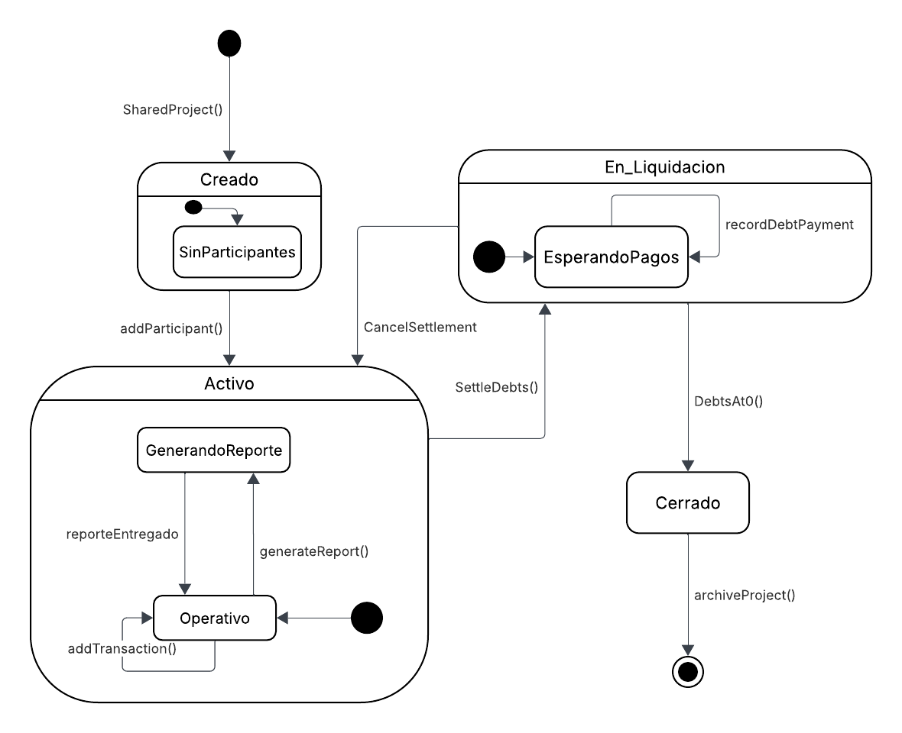</p>

#### User
<p align="center">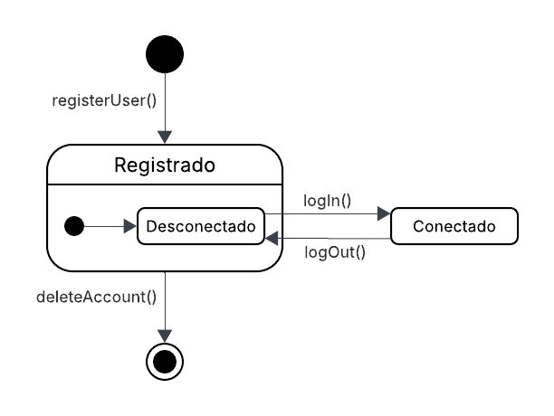</p>

#### Transaction
<p align="center">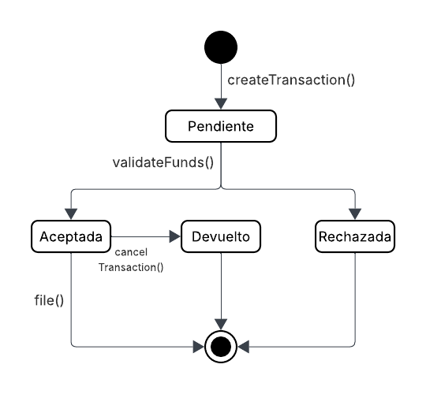</p>

#### PersonalWallet
<p align="center">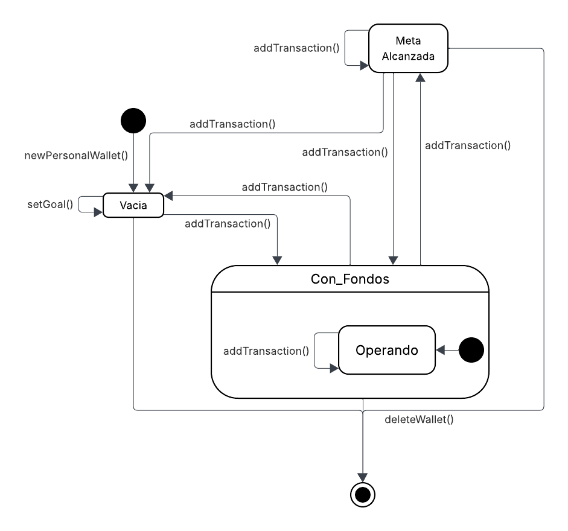</p>
</details>

## Modelo de datos

<p align="center">
  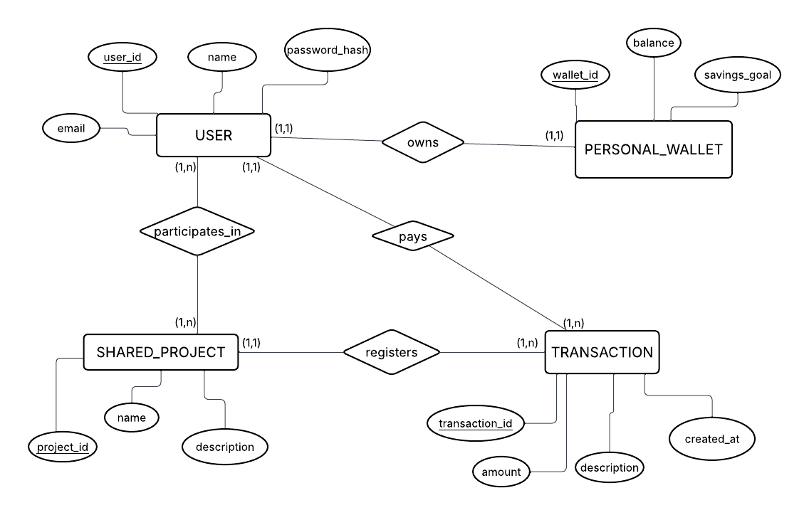
</p>

| Entidad | Descripción |
|---|---|
| `USER` | Usuario del sistema (nombre, correo y contraseña cifrada). |
| `PERSONAL_WALLET` | Billetera personal del usuario (relación 1:1), con saldo y meta de ahorro. |
| `SHARED_PROJECT` | Proyecto compartido entre varios usuarios. |
| `TRANSACTION` | Movimiento de una billetera personal o de un proyecto compartido, con categoría opcional. |
| `CATEGORY` | Categoría de gasto con límite mensual. Pertenece a un usuario (`user_id`), que es el único que puede verla y usarla. |

La relación entre usuarios y proyectos compartidos (N:M) se resuelve con la tabla intermedia `project_participants`.

## Instalación y ejecución

### Requisitos previos

- Java 21
- Node.js (LTS) y npm
- MySQL Server 8.0+
- Git

### 1. Clona el repositorio

```bash
git clone https://github.com/Gago82241/syncfund_.git
cd syncfund_
```

### 2. Backend (`demo/`)

Crea la base de datos y un usuario dedicado en tu MySQL local:

```sql
CREATE DATABASE IF NOT EXISTS syncfund_db;
CREATE USER IF NOT EXISTS 'syncfund_user'@'localhost' IDENTIFIED BY 'TU_CONTRASEÑA';
GRANT ALL PRIVILEGES ON syncfund_db.* TO 'syncfund_user'@'localhost';
```

Crea tu configuración local a partir de la plantilla incluida y complétala con tus credenciales de MySQL y un secreto JWT propio:

```bash
cd demo/src/main/resources
cp application-local.properties.example application-local.properties   # macOS / Linux
Copy-Item application-local.properties.example application-local.properties   # Windows (PowerShell)
```

> `application-local.properties` está excluido del control de versiones y nunca debe subirse al repositorio. En producción, los mismos valores se definen como variables de entorno (`DB_URL`, `DB_USERNAME`, `DB_PASSWORD`, `JWT_SECRET`).

Ejecuta el backend con el perfil `local`:

```bash
cd demo
.\mvnw.cmd spring-boot:run "-Dspring-boot.run.profiles=local"   # Windows
./mvnw spring-boot:run -Dspring-boot.run.profiles=local          # macOS / Linux
```

El backend queda escuchando en `http://localhost:8080`. Hibernate crea las tablas automáticamente en el primer arranque.

> Si tu base de datos ya tiene datos, aplica antes de arrancar los scripts pendientes de `docs/base-de-datos/migraciones/`: Hibernate no migra correctamente una columna obligatoria nueva sobre filas existentes.

### 3. Frontend (`syncfund-frontend/`)

```bash
cd syncfund-frontend
npm install
npm run dev
```

La aplicación queda disponible en `http://localhost:5173`, conectada por defecto a `http://localhost:8080/api`.

## Tecnologías

**Backend**
- [Spring Boot 4.1.1](https://spring.io/projects/spring-boot) (Java 21) — framework principal
- [Spring Data JPA](https://spring.io/projects/spring-data-jpa) + Hibernate — persistencia
- [Spring Security](https://spring.io/projects/spring-security) + [JJWT](https://github.com/jwtk/jjwt) — autenticación y autorización
- MySQL 8 — base de datos relacional
- Maven — gestor de dependencias

**Frontend**
- [React](https://react.dev/) + [TypeScript](https://www.typescriptlang.org/) — vía [Vite](https://vite.dev/)
- [React Router](https://reactrouter.com/) — enrutamiento
- [Axios](https://axios-http.com/) — cliente HTTP

**Arquitectura y patrones de diseño**
- Arquitectura en capas (Presentación / Aplicación / Dominio / Persistencia)
- Patrón **Observer** (`SharedProject` como sujeto observable, notifica cambios de saldo a sus participantes)
- Autenticación **JWT** sin estado + autorización por recurso (dueño/membresía, no solo "está logueado")

**Infraestructura**
- [Railway](https://railway.com/) — backend y base de datos MySQL en producción
- [Vercel](https://vercel.com/) — frontend en producción
- GitHub — control de versiones

## Recursos útiles

- [Documentación oficial de Spring Boot](https://docs.spring.io/spring-boot/index.html)
- [Documentación oficial de React](https://react.dev/learn)
- [JJWT — librería JWT para Java](https://github.com/jwtk/jjwt)
- [Documentación de Railway](https://docs.railway.com/)
- [Documentación de Vercel](https://vercel.com/docs)
- [Refactoring Guru — patrón Observer](https://refactoring.guru/es/design-patterns/observer)

## Colaboradores

- **Diego Alejandro Pulgarin Gómez** — [@Gago82241](https://github.com/Gago82241)
- **Juan Jose Correa Londoño** — [@juancorrea82232-rgb](https://github.com/juancorrea82232-rgb)
- **Harold Arteaga** — [@HarArte](https://github.com/HarArte)
- **Yorleyner Mazo Cardenas** — [@yorleynermc](https://github.com/yorleynermc)

---

<p align="center">Proyecto académico · Politécnico Colombiano Jaime Isaza Cadavid · 2026</p>
